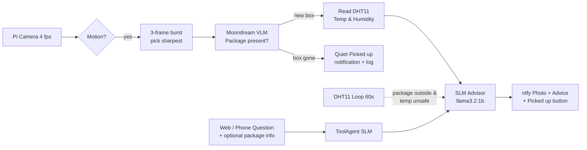

# Package Watcher

A focused LangGraph package-tracking and temperature-advisory agent on a Raspberry Pi 5.

- **Box & delivery detection.** Motion triggers a 3-frame burst and asks **Moondream** (local VLM in Ollama) if a cardboard box or package is present.
- **Package lifecycle tracking.** Tracks **delivered → outside → picked up** so a box sitting on the porch doesn't trigger repeated alerts.
- **Temperature-aware SLM advice.** Reads the **DHT11** temperature and humidity sensor and feeds those readings + box description + time outside to **Llama 3.2 1B** to advise whether to bring the package inside.
- **Follow-up weather alerts.** Re-checks temperature while a package sits outside and warns you (via **ntfy** and optional **buzzer**) if conditions become too hot, cold, or humid.
- **Interactive SLM agent.** Ask *"Should I bring the package inside?"* on the web dashboard or via phone (`ntfy`), optionally adding details like *"It has chocolate and skincare inside"* — the SLM tailors its advice and remembers the contents.
- **Two-way phone alerts & web dashboard.** Delivery notifications include **Picked up**, **Take another**, and **Snooze 1h** buttons. Photos and events also back up to S3 and MQTT/AWS IoT Core.

## How it works



## Hardware

- Raspberry Pi 5 (4 GB or more) with official 27W USB-C power supply
- Pi camera (tested with OV5647)
- DHT11 temperature/humidity sensor on GPIO17 (physical pin 11)
- Optional buzzer on GPIO27 (physical pin 13)

## Setup

```bash
sudo apt install -y python3-picamera2 python3-opencv mosquitto
curl -fsSL https://ollama.com/install.sh | sh
ollama pull moondream
ollama pull llama3.2:1b
pip install -r requirements.txt --break-system-packages
```

### Run

```bash
LIBCAMERA_LOG_LEVELS=*:ERROR python3 package_watcher.py
```

On first run, `~/package-watcher/config.json` is created (or copied from `~/guardian/config.json` if upgrading) with your `ntfy` topics and `web_key`.

### Run as a service

```bash
sudo cp package-watcher.service /etc/systemd/system/
sudo systemctl daemon-reload
sudo systemctl enable --now package-watcher
journalctl -u package-watcher -f
```

## Phone commands (`ntfy`)

Send these to your `cmd_topic`:

| Command | Example / Action |
|---|---|
| `picked up` | Marks the active package as brought inside |
| `snapshot` | Captures and describes the porch right now |
| `status` | Active package duration, deliveries today, outdoor temp |
| `snooze 60` / `resume` | Pauses / resumes alerts |
| `beep` / `alarm` / `off` / `volume 40` | Controls the MQTT buzzer |
| *"Should I bring the package inside? It has chocolate."* | Handled by the SLM agent using live DHT11 readings + your note |

## Agent tools (`tool_agent.py`)

| Tool | Kind | Purpose |
|---|---|---|
| `advise_bring_in` | read/advise | Combines live temp/humidity, time outside, camera description, and user `package_info` |
| `get_packages` | read | Delivery and pickup history (`today`, `yesterday`, `last 24 hours`, `this week`, `this month`) |
| `get_temperature` | read | Outdoor temperature/humidity stats + Pi CPU temperature |
| `get_status` | read | Active package status, snooze, buzzer, sensor state |
| `look_at_porch` | read | Captures a live photo and checks with Moondream |
| `mark_picked_up` | action | Clears active package tracking |
| `sound_buzzer` | action | `beep`, `double`, `alarm`, `chirp`, `off` |
| `snooze_alerts` | action | 0–240 min (requires `yes` confirmation to snooze) |
| `take_snapshot` | action | Sends a photo + description to `ntfy` |

## Evaluation

```bash
python3 eval_agent.py          # tests SLM tool routing & safety in dry_run mode
python3 evaluate.py            # measures Moondream package detection on labeled photos
```
