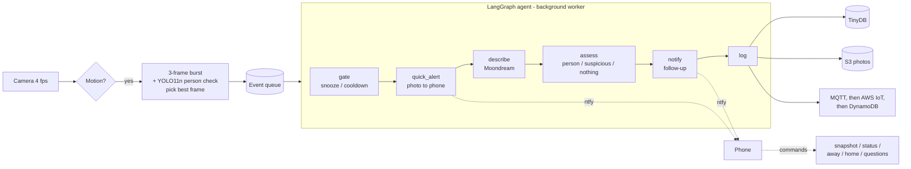
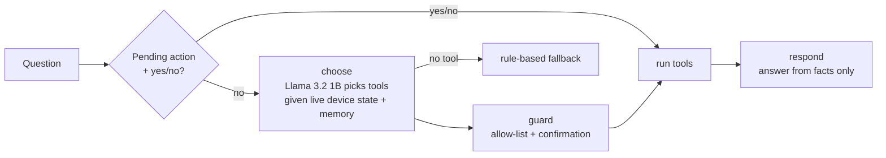

# Room Guardian

A LangGraph agent on a Raspberry Pi 5 that watches a room with the camera, works out what's happening using on-device AI, and alerts your phone, only loudly when it matters.

- **Instant photo alerts.** Motion detection runs all the time. When something moves, the best of a 3-frame burst reaches your phone in about a second.
- **Two AI models working together.** A YOLO11n person detector (ONNX, run by OpenCV with no PyTorch) confirms people. Moondream (a local vision-language model in Ollama) describes the scene in one sentence.
- **Only loud when it matters.** A person or something suspicious (mask, weapon, smoke, fire, broken glass) gets a loud alert. Anything else arrives quietly as "Nothing important".
- **Knows when you're home.** An iPhone location automation switches the guardian between *away* (armed) and *home* (your own movement is ignored), and you get a "while you were out" summary when you get back.
- **Ask it about the past.** *"When did someone last come in?"* or *"Anything happen while I was out?"* are answered from the event log, with the relevant photo attached.
- **Web dashboard with a tool-calling agent.** A timeline, live view and temperature chart, plus a chat box (also on the phone) where a small language model on the Pi picks tools: it answers *"Summarize this week"* or *"How hot did it get today?"* from the event and temperature logs or the camera, and carries out allowed actions like *"sound a beep"* or *"I'm leaving, arm it"*. Every call is checked against an allow-list, disarming and snoozing ask for a "yes" first, and code counts the facts so the model can't invent events. See [Agent](#agent).
- **Buzzer actuator over MQTT.** A buzzer on GPIO27 listens on `fuzail-pi/cmd/buzzer` and reports its state (with command-to-buzzer latency) on `fuzail-pi/state/buzzer`. It sounds an alarm automatically for suspicious events or heat alerts, and can be triggered from the dashboard, the phone, Node-RED or `mosquitto_pub`.
- **Two-way phone control** through [ntfy](https://ntfy.sh), with no account needed: **Take another** and **Snooze 1h** buttons, plus text commands.
- **Offline alert.** A heartbeat to healthchecks.io tells you if the Pi crashes, loses power or goes offline.
- **Cloud backup with auto-expiry.** Photos go to S3, and event records go over MQTT to AWS IoT Core and then DynamoDB. Both are deleted automatically after 30 days.
- **All AI runs on the Pi.** No cloud AI APIs are used.

## How it works



- The camera keeps watching while the AI is busy, because events are processed by a background worker.
- Motion while you're **home** is ignored, so you're not alerted about yourself.
- If the person detector or Moondream misses something, the other can still flag it: **Person spotted** fires if either one finds a person.

## Phone notifications

| Situation | First (~1 s) | Follow-up |
|---|---|---|
| Person (YOLO) or face | 🚨 **Person detected**, loud | **Person spotted**, with a description |
| Any other motion | 👀 **Motion**, quiet photo | ✅ **Nothing important**, or 🚨 if Moondream sees a person |
| Mask, weapon, smoke, fire… | 👀 **Motion** | ⚠️ **Something suspicious**, highest priority |
| You leave or come home | — | 🛡 **Armed** / 🏠 **Welcome back** with a summary |
| Pi or guardian offline | — | **room-guardian is DOWN** (from healthchecks.io) |

## Commands

Send these to your ntfy command topic, e.g. from `https://ntfy.sh/<command-topic>` in a browser:

| Command | What it does |
|---|---|
| `snapshot` | Takes a photo now and describes it |
| `status` | Away/home/snoozed state, today's events, last event |
| `away` / `home` | Arms, or disarms with a summary (normally sent automatically by your phone) |
| `snooze 30` / `resume` | Pauses alerts for N minutes / turns them back on |
| `buzz` / `alarm` / `silence` | Beeps the buzzer / sounds the alarm pattern / stops it |
| `volume 40` | Sets the buzzer volume (5–100%) |
| *"is my laptop on the desk?"* | A question about **now**: takes a photo and answers it |
| *"when did someone last come in?"*, *"summarize this week"*, *"sound the alarm"*, *"disarm"* | Handled by the same agent as the dashboard's Ask box (questions answered with the most relevant photo; actions follow the allow-list and confirmation rules; reply `yes` or `no` to confirm) |

## Hardware

- Raspberry Pi 5 (4 GB or more)
- Pi camera (tested with an OV5647)
- DHT11 temperature/humidity sensor on GPIO17 (pin 11), with a 10 kΩ pull-up for the bare 4-pin version
- Buzzer on GPIO27 (pin 13)
- Official 27W USB-C power supply. Running AI models on a weaker supply causes under-voltage reboots.

## Setup

```bash
# System packages (camera + OpenCV come from apt, not pip)
sudo apt install -y python3-picamera2 python3-opencv opencv-data mosquitto

# Ollama + vision model
curl -fsSL https://ollama.com/install.sh | sh
ollama pull moondream
ollama pull llama3.2:1b          # the agent's small language model (tool calling + answers)

# Python packages
pip install -r requirements.txt --break-system-packages

# Person detector (optional but recommended): YOLO11n exported to ONNX (opset 12)
#   yolo export model=yolo11n.pt format=onnx imgsz=640 opset=12   (on any PC with ultralytics)
#   then copy it to models/yolo11n.onnx
```

### Run

```bash
LIBCAMERA_LOG_LEVELS=*:ERROR python3 room_guardian.py
```

On the first run, it creates two random ntfy topics in `~/guardian/config.json`. Subscribe to the **alerts** topic in the ntfy app, and send commands to the **command** topic. Treat both names like passwords.

### Run as a service (starts at boot, restarts on crash)

```bash
sudo cp room-guardian.service /etc/systemd/system/
sudo systemctl daemon-reload
sudo systemctl enable --now room-guardian
journalctl -u room-guardian -f
```

### Optional integrations

<details>
<summary><b>Offline alert (healthchecks.io)</b></summary>

1. Create a free check on healthchecks.io (period 1 min, grace 1 min) and add an **ntfy** integration with your alerts topic.
2. Add the ping URL to `~/guardian/config.json`: `"healthcheck_url": "https://hc-ping.com/<uuid>"`
</details>

<details>
<summary><b>Auto away/home (iPhone Shortcuts)</b></summary>

Create two personal automations, **Leave** and **Arrive** (your home location, *Run Immediately*). Each one runs **Get Contents of URL**:
- URL `https://ntfy.sh`, method **POST**, body **JSON**
- Fields: `topic` = your command topic, `message` = `away` (for Leave) or `home` (for Arrive)
</details>

<details>
<summary><b>AWS backup with 30-day expiry</b></summary>

- **S3:** add a lifecycle rule on the prefix `guardian/` that expires objects after 30 days.
- **DynamoDB:** create a table `guardian_events` (partition key `id`) with TTL on `expires_at`.
- **IoT Core:** a rule `SELECT * FROM 'fuzail-pi/guardian/event'`, with a DynamoDBv2 action into `guardian_events`. The Pi's Mosquitto bridge forwards `fuzail-pi/#` to IoT Core.
- The Pi needs AWS credentials with `s3:PutObject` on the bucket.
</details>

<details>
<summary><b>Cloud alerts and cloud detection (edge vs cloud)</b></summary>

- **Email alerts (SNS):** IoT rule `SELECT id, timestamp, trigger, reason, description, s3_key FROM 'fuzail-pi/guardian/event' WHERE (alert = true AND startswith(reason, 'Looks suspicious')) OR trigger = 'heat'` with an SNS action to topic `guardian-alerts` (email subscription).
- **Cloud detection (Lambda + Rekognition):** [`cloud/rekognition_lambda.py`](cloud/rekognition_lambda.py) runs on every photo uploaded to `guardian/events/` in S3 (us-east-1), calls Amazon Rekognition `DetectLabels`, and stores the result in DynamoDB `guardian_cloud` (key `id`, TTL `expires_at`).
- **Comparison:** `python3 evaluate.py --cloud 200` sends the hand-labeled photos to Rekognition and adds an *Edge vs cloud* table (accuracy, time per photo, offline, privacy, cost) to `eval/results.md`. The Pi's AWS credentials need `rekognition:DetectLabels`.
</details>

## Configuration

These settings are at the top of `room_guardian.py`.

| Setting | Default | Meaning |
|---|---|---|
| `MOTION_THRESHOLD` | `0.01` | Fraction of the frame that must change. Raise it if light or shadows cause events |
| `EVENT_COOLDOWN` | `20` | Seconds between automatic events |
| `SHORT_EXPOSURE` | `True` | Less motion blur (slightly grainier in the dark) |
| `BURST_FRAMES` | `3` | Frames per event; the best one is kept |
| `PERSON_CONF` | `0.40` | YOLO confidence needed to count a person |
| `VISION_SERVERS` | Pi only | Add a faster machine first (e.g. a laptop over Tailscale) to offload Moondream |
| `PRESENCE_ENABLED` | `True` | Ignore motion while you're home |
| `UPLOAD_TO_S3` / `RETENTION_DAYS` | `True` / `30` | Cloud backup and expiry |
| `SUSPICIOUS_PATTERN` | — | Words that mark an event as suspicious |
| `BUZZER_PASSIVE` / `BUZZER_ACTIVE_LOW` | `False` / `False` | Your buzzer's type: run `python3 actuators.py` to find it |
| `BUZZER_VOLUME` | `0.6` | Starting volume (PWM). Change it live with the dashboard slider, the phone command `volume 40`, or MQTT `{"action": "volume", "volume": 0.4}`; the last setting is remembered |
| `BUZZER_ON_SUSPICIOUS` / `BUZZER_ON_PERSON` / `BUZZER_ON_HEAT` | `True` / `False` / `True` | Which events sound the buzzer (only while away, except heat) |

## Evaluation

How well does it work? `evaluate.py` measures it against hand-labeled photos:

1. Open `/label` on the dashboard and mark each event photo **Person**, **No person** or **Unclear** (keys P / N / U). The AI's answers are hidden so they can't bias the labels.
2. Run `python3 evaluate.py` on the Pi (add `--moondream 20` to also time Moondream directly).
3. The report is written to [`eval/results.md`](eval/results.md):
   - precision, recall and false-alarm rate for the whole system and for each detector (YOLO11n, Moondream, face detector), with 95% confidence intervals
   - a YOLO11n confidence-threshold sweep
   - latency for each stage, from motion to phone notification, measured on every event.

## Agent

The Ask box and phone questions go to a tool-calling agent (`tool_agent.py`, a LangGraph graph):



| Tool | Kind | Allowed values | Needs "yes"? |
|---|---|---|---|
| `get_events`, `get_temperature` | read | period: today, yesterday, last 24 hours, this week, this month, since I left | – |
| `get_status`, `look_at_room` | read | – | – |
| `sound_buzzer` | action | beep, double, alarm, chirp, off | no |
| `set_mode` | action | away, home | disarming (home) |
| `snooze_alerts` | action | 0–240 minutes (0 resumes) | snoozing |
| `take_snapshot` | action | – | no |

- Anything else (unknown tools, values outside the list, commands like *"turn off the camera"*) is refused and logged. Safety is enforced in code, so a wrong model choice can't bypass it.
- Memory: the last 3 questions and answers per session (dashboard, phone), so follow-ups like *"what about yesterday?"* work.
- Every request is logged to `~/guardian/agent_log.jsonl` (calls, decisions, timings).
- If the model is unavailable or picks no tool, the earlier rule-based agent answers instead.
- Settings: `AGENT_ENGINE` (`"tools"` or `"rules"`), `TOOL_MODEL` (e.g. `llama3.2:3b` or `granite3.1-moe:1b`).

**Evaluate it:** `python3 eval_agent.py` sends the 32 test cases in [`eval/agent_cases.json`](eval/agent_cases.json) to the running guardian in test mode (actions are checked but not carried out) and writes [`eval/agent_results.md`](eval/agent_results.md): tool-choice and argument accuracy, unsafe requests blocked, confirmations enforced, unrequested actions, fallback rate and response time. Compare models with `--model llama3.2:3b`.

## Data and privacy

- Local: photos in `~/guardian/events/` (only the newest 500 are kept), the log in `~/guardian/events.json`, and settings and secrets in `~/guardian/config.json`. **None of these are in the repository.**
- Alert photos pass through ntfy.sh, which keeps attachments for about 3 hours. Anyone who knows your topic names can read your alerts, so keep them private.
- Only record people who know about the camera.

## Tech stack

Python · LangGraph · LangChain · Ollama (Moondream, Llama 3.2 1B) · OpenCV DNN (YOLO11n ONNX) · Picamera2 · ntfy · MQTT (Mosquitto, AWS IoT Core) · AWS S3 and DynamoDB · healthchecks.io · Tailscale

## License notes

The YOLO11 model weights are by Ultralytics under AGPL-3.0, and are not included in this repository.
