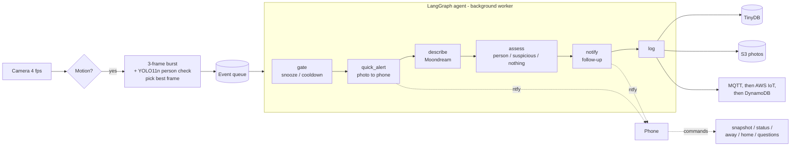

# Room Guardian

A LangGraph agent on a Raspberry Pi 5 that watches a room with the camera, works out what's happening using on-device AI, and alerts your phone, only loudly when it matters.

- **Instant photo alerts.** Motion detection runs all the time. When something moves, the best of a 3-frame burst reaches your phone in about a second.
- **Two AI models working together.** A YOLO11n person detector (ONNX, run by OpenCV with no PyTorch) confirms people. Moondream (a local vision-language model in Ollama) describes the scene in one sentence.
- **Only loud when it matters.** A person or something suspicious (mask, weapon, smoke, fire, broken glass) gets a loud alert. Anything else arrives quietly as "Nothing important".
- **Knows when you're home.** An iPhone location automation switches the guardian between *away* (armed) and *home* (your own movement is ignored), and you get a "while you were out" summary when you get back.
- **Ask it about the past.** *"When did someone last come in?"* or *"Anything happen while I was out?"* are answered from the event log, with the relevant photo attached.
- **Two-way phone control** through [ntfy](https://ntfy.sh), with no account needed: **Take another** and **Snooze 1h** buttons, plus text commands.
- **Offline alert.** A heartbeat to healthchecks.io tells you if the Pi crashes, loses power or goes offline.
- **Cloud backup with auto-expiry.** Photos go to S3, and event records go over MQTT to AWS IoT Core and then DynamoDB. Both are deleted automatically after 30 days.
- **All AI runs on the Pi.** No cloud AI APIs are used.

## How it works



- The camera keeps watching while the AI is busy, because events are processed by a background worker.
- Motion while you're **home** is ignored, so you're not alerted about yourself.
- If the person detector or Moondream misses something, the other can still flag it: **Person spotted** fires if either one finds a person.

## Phone notifications

| Situation | First (~1 s) | Follow-up |
|---|---|---|
| Person (YOLO) or face | 🚨 **Person detected**, loud | **Person spotted**, with a description |
| Any other motion | 👀 **Motion**, quiet photo | ✅ **Nothing important**, or 🚨 if Moondream sees a person |
| Mask, weapon, smoke, fire… | 👀 **Motion** | ⚠️ **Something suspicious**, highest priority |
| You leave or come home | — | 🛡 **Armed** / 🏠 **Welcome back** with a summary |
| Pi or guardian offline | — | **room-guardian is DOWN** (from healthchecks.io) |

## Commands

Send these to your ntfy command topic, e.g. from `https://ntfy.sh/<command-topic>` in a browser:

| Command | What it does |
|---|---|
| `snapshot` | Takes a photo now and describes it |
| `status` | Away/home/snoozed state, today's events, last event |
| `away` / `home` | Arms, or disarms with a summary (normally sent automatically by your phone) |
| `snooze 30` / `resume` | Pauses alerts for N minutes / turns them back on |
| *"is my laptop on the desk?"* | A question about **now**: takes a photo and answers it |
| *"when did someone last come in?"* | A question about **the past**: answered from the event log |

## Hardware

- Raspberry Pi 5 (4 GB or more)
- Pi camera (tested with an OV5647)
- Official 27W USB-C power supply. Running AI models on a weaker supply causes under-voltage reboots.

## Setup

```bash
# System packages (camera + OpenCV come from apt, not pip)
sudo apt install -y python3-picamera2 python3-opencv opencv-data mosquitto

# Ollama + vision model
curl -fsSL https://ollama.com/install.sh | sh
ollama pull moondream
ollama pull llama3.2:1b          # used for history answers (and the optional USE_LLM_ASSESS)

# Python packages
pip install -r requirements.txt --break-system-packages

# Person detector (optional but recommended): YOLO11n exported to ONNX (opset 12)
#   yolo export model=yolo11n.pt format=onnx imgsz=640 opset=12   (on any PC with ultralytics)
#   then copy it to models/yolo11n.onnx
```

### Run

```bash
LIBCAMERA_LOG_LEVELS=*:ERROR python3 room_guardian.py
```

On the first run, it creates two random ntfy topics in `~/guardian/config.json`. Subscribe to the **alerts** topic in the ntfy app, and send commands to the **command** topic. Treat both names like passwords.

### Run as a service (starts at boot, restarts on crash)

```bash
sudo cp room-guardian.service /etc/systemd/system/
sudo systemctl daemon-reload
sudo systemctl enable --now room-guardian
journalctl -u room-guardian -f
```

### Optional integrations

<details>
<summary><b>Offline alert (healthchecks.io)</b></summary>

1. Create a free check on healthchecks.io (period 1 min, grace 1 min) and add an **ntfy** integration with your alerts topic.
2. Add the ping URL to `~/guardian/config.json`: `"healthcheck_url": "https://hc-ping.com/<uuid>"`
</details>

<details>
<summary><b>Auto away/home (iPhone Shortcuts)</b></summary>

Create two personal automations, **Leave** and **Arrive** (your home location, *Run Immediately*). Each one runs **Get Contents of URL**:
- URL `https://ntfy.sh`, method **POST**, body **JSON**
- Fields: `topic` = your command topic, `message` = `away` (for Leave) or `home` (for Arrive)
</details>

<details>
<summary><b>AWS backup with 30-day expiry</b></summary>

- **S3:** add a lifecycle rule on the prefix `guardian/` that expires objects after 30 days.
- **DynamoDB:** create a table `guardian_events` (partition key `id`) with TTL on `expires_at`.
- **IoT Core:** a rule `SELECT * FROM 'fuzail-pi/guardian/event'`, with a DynamoDBv2 action into `guardian_events`. The Pi's Mosquitto bridge forwards `fuzail-pi/#` to IoT Core.
- The Pi needs AWS credentials with `s3:PutObject` on the bucket.
</details>

## Configuration

These settings are at the top of `room_guardian.py`.

| Setting | Default | Meaning |
|---|---|---|
| `MOTION_THRESHOLD` | `0.01` | Fraction of the frame that must change. Raise it if light or shadows cause events |
| `EVENT_COOLDOWN` | `20` | Seconds between automatic events |
| `SHORT_EXPOSURE` | `True` | Less motion blur (slightly grainier in the dark) |
| `BURST_FRAMES` | `3` | Frames per event; the best one is kept |
| `PERSON_CONF` | `0.40` | YOLO confidence needed to count a person |
| `VISION_SERVERS` | Pi only | Add a faster machine first (e.g. a laptop over Tailscale) to offload Moondream |
| `PRESENCE_ENABLED` | `True` | Ignore motion while you're home |
| `UPLOAD_TO_S3` / `RETENTION_DAYS` | `True` / `30` | Cloud backup and expiry |
| `SUSPICIOUS_PATTERN` | — | Words that mark an event as suspicious |

## Data and privacy

- Local: photos in `~/guardian/events/` (only the newest 500 are kept), the log in `~/guardian/events.json`, and settings and secrets in `~/guardian/config.json`. **None of these are in the repository.**
- Alert photos pass through ntfy.sh, which keeps attachments for about 3 hours. Anyone who knows your topic names can read your alerts, so keep them private.
- Only record people who know about the camera.

## Tech stack

Python · LangGraph · LangChain · Ollama (Moondream, Llama 3.2 1B) · OpenCV DNN (YOLO11n ONNX) · Picamera2 · ntfy · MQTT (Mosquitto, AWS IoT Core) · AWS S3 and DynamoDB · healthchecks.io · Tailscale

## License notes

The YOLO11 model weights are by Ultralytics under AGPL-3.0, and are not included in this repository.
